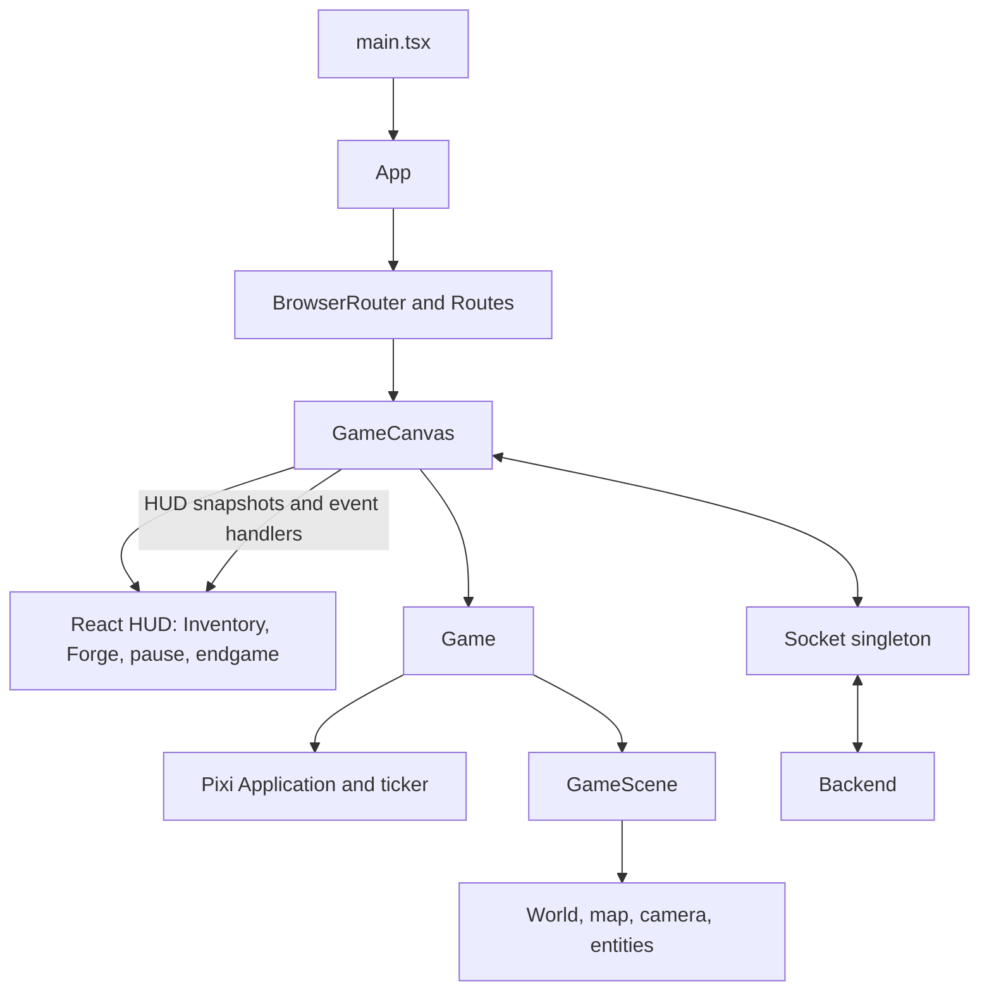

# Frontend

## 1. Overview

The frontend is a React single-page application for a multiplayer isometric
castle-survival game. It provides:

- account creation, sign-in, session restoration, logout, email/password
  recovery, and two-factor authentication;
- room creation, room discovery, joining, lobby updates, and game start;
- a PixiJS-rendered game world with players, castles, resources, weapons,
  catapults, projectiles, and camera movement;
- React HUD and menus for health, inventory, forge actions, castle upgrades,
  pausing, spectating, and end-game results.

The frontend owns presentation, local input, rendering, and optimistic local
movement. The backend owns authentication, room membership, authoritative
movement correction, combat results, resources, upgrades, catapults, and win
conditions. HTTP is used for account/session operations; Socket.IO is used for
lobbies and real-time game state.

The application is initialized by [`src/main.tsx`](./src/main.tsx), which mounts
[`App`](./src/App.tsx). `App` owns top-level user and joined-game state and
renders routes. [`GameCanvas`](./src/pages/GameCanvas.tsx) creates and destroys
a Pixi [`Game`](./src/game/Game.ts) instance and translates socket events into
game-engine calls and React HUD state.

Detailed guides:

- [Architecture](./docs/ARCHITECTURE.md)
- [Game engine](./docs/GAME_ENGINE.md)
- [Multiplayer](./docs/MULTIPLAYER.md)
- [Development](./docs/DEVELOPMENT.md)

## 2. Technology Stack

| Technology                           | Use in this frontend                                               |
| ------------------------------------ | ------------------------------------------------------------------ |
| React 19                             | Component-based UI and local page/HUD state                        |
| TypeScript 6                         | Typed React, socket payloads, and game entities                    |
| Vite 8                               | Development server, HMR, module graph, and production bundling     |
| PixiJS 8                             | WebGL/canvas rendering, sprites, animation, containers, and ticker |
| Socket.IO Client 4                   | Persistent lobby and multiplayer game connection                   |
| React Router DOM 7                   | Browser routes and navigation                                      |
| i18next + react-i18next              | English, Dutch, Russian, and Ukrainian translations                |
| Tailwind CSS 4 + `@tailwindcss/vite` | Utility-first UI styling through the Vite plugin                   |
| ESLint 10                            | JavaScript/TypeScript linting                                      |
| Prettier 3                           | Formatting checks and formatting                                   |

There is no Redux, Zustand, React Context, custom hook directory, or frontend
HTTP service layer. Fetch calls are made in the relevant pages and global
session logic in `App.tsx`.

## 3. Project Structure

```text
frontend/
├── Dockerfile
├── eslint.config.js
├── index.html
├── package.json
├── package-lock.json
├── tsconfig.json
├── tsconfig.app.json
├── tsconfig.node.json
├── vite.config.ts
├── docs/
│   ├── ARCHITECTURE.md
│   ├── DEVELOPMENT.md
│   ├── GAME_ENGINE.md
│   └── MULTIPLAYER.md
└── src/
    ├── App.tsx
    ├── main.tsx
    ├── index.css
    ├── socket.ts
    ├── assets/
    │   ├── player and terrain textures
    │   ├── castle and castle-boon textures
    │   ├── catapult textures
    │   └── weapons/{axe,dagger,spear,sword}/
    ├── components/
    │   ├── Forgemenu.tsx
    │   ├── Inventory.tsx
    │   └── LanguageSwitcher.tsx
    ├── game/
    │   ├── Game.ts
    │   ├── assets/loadGameTextures.ts
    │   ├── config/constants.ts
    │   ├── entities/
    │   │   ├── Castle.ts
    │   │   ├── Inventory.ts
    │   │   ├── Player.ts
    │   │   ├── RemotePlayer.ts
    │   │   ├── catapult.ts
    │   │   └── weapons/{weapon,axe,dagger,spear,sword}.ts
    │   ├── scenes/GameScene.ts
    │   ├── systems/{Camera,Input}.ts
    │   └── world/{GameMap,TileType,iso,tileResource}.ts
    ├── i18n/
    │   ├── index.ts
    │   └── locales/{en,nl,ru,uk}.ts
    ├── pages/
    │   ├── authentication and recovery pages
    │   ├── lobby and room pages
    │   ├── game menu, canvas, pause, and end-game pages
    │   └── small prop/type definitions
    └── types/
        ├── game.ts
        └── user.ts
```

`components/` contains reusable React UI. `pages/` contains route-level screens.
`game/` is an imperative PixiJS subsystem and does not use React rendering.
`socket.ts` is the singleton Socket.IO connection wrapper. `types/game.ts`
defines the shared frontend representation of room, map, player, inventory, and
attack payloads. Assets are imported by Vite and loaded into Pixi textures by
`loadGameTextures.ts`.

## 4. Application Architecture

### Entry point and routing

`main.tsx` imports global CSS and i18n, finds `#root`, and renders `App`. `App`
wraps `AppContent` in `BrowserRouter`. `AppContent` checks `GET /api/auth/me`,
monitors `GET /api/ping`, and conditionally redirects unauthenticated users from
protected routes to `/login`.

Routes currently defined in `App.tsx` are:

| Route                      | Screen/guard                         |
| -------------------------- | ------------------------------------ |
| `/`                        | Main menu                            |
| `/signup`                  | Registration                         |
| `/login`                   | Sign-in                              |
| `/forgot-password`         | Password-reset request               |
| `/reset-password`          | Token-based password reset           |
| `/game-menu`               | Authenticated game menu              |
| `/game-menu/create-room`   | Authenticated room creation          |
| `/game-menu/join-room`     | Authenticated room browser/code join |
| `/game-menu/room/:roomId`  | Authenticated lobby                  |
| `/game`                    | Reconnected or active game           |
| `/settings`                | Settings                             |
| `/settings/password-reset` | Authenticated password-reset request |
| `/settings/2fa`            | Two-factor settings                  |
| `/settings/2fa/setup`      | Two-factor setup confirmation        |
| `/verify-2fa`              | Login-time two-factor verification   |
| `/disconnected`            | Backend unavailable screen           |
| `*`                        | Redirect to `/`                      |

### Component and engine relationship



`Game.start()` initializes a Pixi `Application`, appends its canvas to the
React-owned `div`, loads all textures, creates `GameScene`, and starts the
ticker. Each ticker frame updates weapon animations, remote hit animations,
input-driven scene state, camera, visible map tiles, catapults, and boulders.
The cleanup function in `GameCanvas` removes every listener, clears its
interval, calls `game.destroy()`, and destroys the Pixi application.

React does not render game sprites. It polls small engine snapshots every 32 ms
for inventory, castle direction, and proximity flags, while socket handlers
update React state for HP, castle HP/level, opponents, armor, spectating, and
the winner.

## 5. Authentication and User Flow

- **Registration:** `SignUp.tsx` validates required fields, password equality,
  and privacy/terms checkboxes, then posts `/api/auth/register` with `username`,
  `email`, `password`, `acceptedPrivacy`, and `acceptedTerms`.
- **Login:** `Login.tsx` posts `/api/auth/signin` with email/password and
  `credentials: 'include'`. A successful response supplies `data.user`. When
  `data.requireTwoFactor` is true, the screen navigates to `/verify-2fa`;
  otherwise the socket is initialized and `App` navigates to `/game-menu`.
- **Session:** on startup `App` calls `/api/auth/me` with credentials. The
  frontend stores the returned user in React state; it does not persist an
  access token in browser storage.
- **Logout:** `App.logout()` posts `/api/auth/logout`, disconnects Socket.IO,
  clears joined game state and `gameRoomId`, and returns to `/`.
- **Password reset:** `ForgotPassword.tsx` and `PasswordResetRequest.tsx` post
  `/api/auth/password-reset/request`. `ResetPassword.tsx` posts
  `/api/auth/password-reset` with a reset `token` and new password.
- **Two-factor authentication:** login verification posts
  `/api/auth/2fa/verify`, then re-checks `/api/auth/me`. Settings use
  `/api/auth/2fa/status`, `/api/auth/2fa/setup` (password and returned QR code),
  `/api/auth/2fa/confirm` (token), and `/api/auth/2fa/disable` (password).
- **Email verification:** no frontend email-verification page or direct
  email-verification fetch is implemented in `src`. The Vite proxy reserves
  `/verify-email`, indicating that verification is handled by backend/proxy
  routing rather than an implemented React screen.

The server health loop runs every two seconds after authentication (and on the
disconnected route). Three failed `/api/ping` checks clear user/game state,
disconnect the socket, and navigate to `/disconnected`. A successful check from
that screen returns to `/`.

## 6. Game Architecture

The game uses a logical map (`MAP_SIZE`), 64x32 isometric tiles, and
client-side projection:

```ts
export function isoX(x: number, y: number) {
    return (x - y) * (tileWidth / 2);
}
```

`GameMap` starts with grass, applies server-provided wood/iron spawn points, and
maintains a pool of 3,500 sprites. Each frame it computes the visible grid from
camera bounds and only positions visible tiles. `GameScene` creates the map,
local player, remote players, and one castle per server castle zone.

- **Initialization:** `GameCanvas` creates `Game`; `Game.start()` initializes
  Pixi with `resizeTo: window`, high-DPI density, and device-pixel resolution.
- **Player:** `Player` stores grid coordinates, inventory, direction, armor, and
  weapon. WASD movement is locally predicted and clamped to the map.
  `RemotePlayer` renders server positions and chooses walking direction from
  position deltas.
- **Input:** `Input` listens on `window`; W/A/S/D move, F requests player
  attack, and R emits a castle attack. Blur clears stuck keys. E is queued by
  the input class but is not consumed by `GameScene` in the current frontend.
- **Camera:** `Camera` smoothly follows the local player, clamps to map bounds,
  and moves the Pixi world container.
- **Rendering and animation:** `AnimatedSprite` handles two-frame directional
  player animations. Depth is approximated with `zIndex = gridX + gridY`.
  Weapons have four directional textures and per-weapon attack animation.
- **Castles:** `Castle` displays levels 1–4, health bars, and a destroyed
  texture. The backend-provided level and health are authoritative; the frontend
  changes only the visual representation.
- **Resources/inventory:** `GameMap` displays grass, wood, and iron. Resource
  collection removes a tile and synchronizes wood/iron from the server. React
  `Inventory` displays engine snapshots.
- **Forge and upgrades:** `Forgemenu` emits `craftweapon`, `equiparmor`,
  `new_catapult`, and `upgrade_castle` through the socket. Recipes and
  availability are enforced in the UI, while the backend returns the
  authoritative inventory/result.
- **Catapults:** `Catapult` interpolates movement for 250 ms, shows health, uses
  directional idle/moving/firing textures, fades broken catapults, and is
  removed after its broken animation.
- **Projectiles:** castle and catapult attack events create boulders that move
  linearly between grid points with a parabolic visual arc. The frontend does
  not calculate hit results.
- **HUD:** `GameCanvas` overlays HP, healing/armor indicators, castle pointer,
  inventory, forge, opponents, pause menu, and winner state over the Pixi
  canvas.

Mechanics not represented in these files should not be inferred as frontend
features. In particular, collision, damage calculation, resource authority, and
win determination are backend responsibilities.

## 7. Multiplayer and Socket Communication

[`src/socket.ts`](./src/socket.ts) lazily creates one `io()` connection and
returns it to all pages. `disconnectSocket()` removes listeners, disconnects,
and clears the singleton. No custom reconnection policy is configured; Socket.IO
client defaults apply. `GameCanvas` answers `poll` acknowledgements.

### Client-to-server events

| Event            | Sent by                           | Payload/result                               |
| ---------------- | --------------------------------- | -------------------------------------------- |
| `get_rooms`      | `JoinRoom`                        | No payload                                   |
| `create_room`    | `CreateRoom`                      | `{ name }`                                   |
| `join_room`      | `App` restore, `Room`, `JoinRoom` | `{ roomId }`                                 |
| `join_room_code` | `JoinRoom`                        | `{ code }`                                   |
| `game_start`     | `Room`                            | No payload                                   |
| `leave_room`     | room/game/endgame flows           | No payload                                   |
| `player_move`    | `GameScene`                       | `{ x, y, moving }`                           |
| `player_attack`  | `GameScene`                       | `{ direction }`, ack `{ ok }`                |
| `castleattack`   | `GameScene`                       | No payload                                   |
| `upgrade_castle` | `GameCanvas`                      | `{}`, ack `UpgradeCastleResult`              |
| `craftweapon`    | `Forgemenu`                       | `{ weapon }`, ack success/failed result      |
| `equiparmor`     | `Forgemenu`                       | `{}`, timeout-wrapped ack                    |
| `new_catapult`   | `Forgemenu`                       | `{ targetUserId }`, ack `{ ok, inventory? }` |

### Server-to-client events

| Event                           | Payload consumed by frontend                            |
| ------------------------------- | ------------------------------------------------------- |
| `connect`                       | Socket.IO connection; logged by `socket.ts`             |
| `joined`                        | `JoinedPayload`: room, local player, map, all players   |
| `join_error`                    | `{ message }`                                           |
| `rooms_list`                    | `LobbyRoom[]`                                           |
| `room_update`                   | Room/lobby data handled by `Room`                       |
| `gamestart`                     | Joined game data handled by `Room`                      |
| `player_joined` / `player_left` | `PlayerData`                                            |
| `player_move`                   | `{ socketId, x, y, moving }`                            |
| `player_hp`                     | `{ socketId, hp, reason }`                              |
| `player_died`                   | `{ player: PlayerData }`                                |
| `player_attacked`               | `{ socketId, direction }`                               |
| `player_weapon_equipped`        | `{ socketId, weapon }`                                  |
| `resource_collected`            | `{ x, y, playerId, inventory: { wood, iron } }`         |
| `resource_spawned`              | `{ x, y, type: 'wood' \| 'iron' }`                         |
| `castle_update`                 | `{ socketId, level }`                                   |
| `castle_attack_started`         | `{ socketId, start, target, durationMs }`               |
| `castle_damaged`                | `{ playerSlot, health, level }`                         |
| `catapult_spawn`                | `{ catapultId, position }`                              |
| `catapult_move`                 | `{ catapultId, position }`                              |
| `catapult_fire`                 | `{ catapultId, direction }`                             |
| `catapult_damaged`              | `{ catapultId, health, maxHealth }`                     |
| `catapult_broken`               | `{ catapultId }`                                        |
| `catapult_attack`               | `{ start, target, durationMs }`                         |
| `armor`                         | `{ armor: boolean }`                                    |
| `game_end`                      | `{ winnerid }`                                          |
| `poll`                          | callback acknowledgement; frontend replies with `ack()` |

`GameCanvas` registers all game handlers on mount and removes the exact same
handlers on cleanup. Local movement is predicted immediately; a `player_move`
event whose `socketId` matches the local socket corrects the local position,
while other IDs update `RemotePlayer`.

## 8. State Management

Top-level React state in `AppContent` contains `loading`, `user`, `joinedData`,
and `restoringGame`. Page components keep form and screen state locally.
`GameCanvas` keeps HUD state locally and stores the imperative `Game` in a ref.

The Pixi side owns positions, animation, map tiles, castles, catapults, weapons,
and the engine inventory. React reads snapshots through
`getInventorySnapshot()`, `getCastlePointerSnapshot()`, and
`isPlayerNearCastle()`. Server events update both sides where necessary.
Server-authoritative values are never permanently trusted from local prediction:
movement corrections, inventory acknowledgements, castle updates, HP events, and
game-end events come from Socket.IO.

## 9. Internationalization

`src/i18n/index.ts` registers `en`, `nl`, `ru`, and `uk`, reads the selected
language from `localStorage.language`, and falls back to English. Components use
`useTranslation()` or the imported `t` helper:

```tsx
const { t } = useTranslation();
return <button>{t('openForge')}</button>;
```

Add a string to all four `src/i18n/locales/*.ts` translation objects, then use
the same key in a component. `LanguageSwitcher` calls `i18n.changeLanguage()`
and persists the selected language. Interpolation is used for keys such as
`requiresCastleLevel` with `{ level }`.

## 10. Styling and UI

Styling is Tailwind utility classes directly in TSX. Tailwind is enabled by
`@tailwindcss/vite` in `vite.config.ts`; `index.css` contains the global
stylesheet entry. Reusable UI patterns include dark translucent panels, rounded
cards, amber primary actions, red error/status states, responsive `min-h-screen`
layouts, and absolute overlays over the game canvas.

The game HUD uses pointer-events selectively: decorative overlays are
non-interactive while inventory, forge, and pause controls explicitly restore
pointer events. No separate CSS component library or responsive breakpoint
configuration is present.

## 11. API and Backend Integration

### HTTP

The frontend uses relative `fetch` URLs, so the browser talks to the same
origin. The Vite development proxy sends `/api`, `/verify-email`, and
`/setup-2fa` to `http://backend:3000`. Authenticated requests that need the
session cookie use `credentials: 'include'`; the frontend does not manage bearer
tokens.

HTTP endpoints referenced in `src` are:

```text
GET  /api/auth/me
POST /api/auth/register
POST /api/auth/signin
POST /api/auth/logout
GET  /api/ping
POST /api/auth/password-reset/request
POST /api/auth/password-reset
GET  /api/auth/2fa/status
POST /api/auth/2fa/setup
POST /api/auth/2fa/confirm
POST /api/auth/2fa/disable
POST /api/auth/2fa/verify
```

Pages parse JSON responses and display `data.message` where available. Network
failures are converted to localized status messages in forms; the global health
check logs failures and transitions to `/disconnected`.

### WebSocket

Room and game operations use the singleton Socket.IO connection described in
[MULTIPLAYER.md](./docs/MULTIPLAYER.md). HTTP and socket state are separate:
HTTP establishes/restores the browser session, while socket events establish
room/game membership and deliver real-time state.

## 12. Development Setup

From `frontend/`:

```bash
npm ci
npm run dev
npm run build
npm run typecheck
npm run lint
npm run format:check
npm run format
npm run preview
```

`package.json` has no test script and no test framework is configured. The
development Docker service is defined in the repository-level
`docker-compose-dev.yaml`; from the repository root:

```bash
docker compose -f docker-compose-dev.yaml up --build frontend backend nginx_dev
```

The frontend container runs Vite on `0.0.0.0` and the compose healthcheck
expects port 5173. See [DEVELOPMENT.md](./docs/DEVELOPMENT.md) for the exact
configuration and troubleshooting notes.

## 13. Environment Variables

No frontend environment variables are read. There are no `VITE_*`,
`import.meta.env`, or `process.env` references under `frontend/src`, and no
`.env` file is tracked in `frontend/`.

The development backend target is hard-coded as `http://backend:3000` in
`vite.config.ts`. This is a Docker/service-network setting, not a configurable
frontend environment variable.

## 14. Build and Production

`npm run build` runs `tsc -b` and then `vite build`. Vite bundles imported
TypeScript/React modules and image assets into `dist/`. `npm run preview` serves
the generated build locally. The checked-in frontend Dockerfile is a development
image: it installs dependencies and starts Vite, rather than building or serving
`dist/`.

Production deployment is integrated at the repository level through the
`nginx_prod` service in `docker-compose.yaml`; no production Nginx configuration
is located under `frontend/`. The frontend itself uses relative HTTP and
Socket.IO URLs, so the reverse proxy must expose the application and forward
API/WebSocket traffic to the corresponding services.

## 15. Testing and Code Quality

There is no configured test runner or test directory in `frontend`. Available
quality commands are:

- `npm run typecheck` — TypeScript without emitting files;
- `npm run build` — project-reference type build followed by Vite build;
- `npm run lint` — ESLint;
- `npm run format:check` — Prettier verification.

TypeScript enables strict unused-local/unused-parameter checks, bundler module
resolution, React JSX transform, and no emit. ESLint ignores `dist` and uses the
React Hooks and React Refresh plugins. Components use typed props files where a
page needs a callback contract; game payloads are centralized in
`types/game.ts`.

## 16. Troubleshooting

| Symptom                             | Likely cause and remedy                                                                                                                                                    |
| ----------------------------------- | -------------------------------------------------------------------------------------------------------------------------------------------------------------------------- |
| API requests fail in development    | Start the backend and use the Vite dev server or `docker-compose-dev.yaml`; the proxy target is `backend:3000`.                                                            |
| Browser shows `/disconnected`       | `GET /api/ping` failed three consecutive times. Check backend health, proxy routing, and container networking.                                                             |
| Game does not restore after refresh | `gameRoomId` is only a room hint. The session must restore through `/api/auth/me`, then Socket.IO must successfully emit `join_room`.                                      |
| Socket events appear duplicated     | Ensure the page unmounted cleanly; `GameCanvas` and room pages remove listeners in their effect cleanup. Avoid creating ad-hoc sockets instead of using `connectSocket()`. |
| Canvas is blank                     | Check texture loading and that `GameCanvas` has a `JoinedPayload`; `Game.start()` appends the Pixi canvas only after `Application.init()`.                                 |
| Controls remain stuck               | Refocus the page; `Input` clears keys on `window.blur`. WASD moves, F attacks, and R launches the castle attack.                                                           |
| Changes are not reflected in Docker | The dev compose mounts `./frontend` at `/workspace/app`; rebuild if dependencies or the image command changed.                                                             |
| TypeScript fails on unused code     | `tsconfig.app.json` enables `noUnusedLocals` and `noUnusedParameters`; remove unused imports/parameters or wire them into the implementation.                              |
| A translation is missing            | Add the key to `en.ts`, `nl.ts`, `ru.ts`, and `uk.ts`; English is only the runtime fallback.                                                                               |

## Verification Notes

The documentation was checked against the tracked frontend source, package
scripts, Vite configuration, Dockerfile, and repository Docker Compose files. No
frontend tests, frontend environment variables, implemented email verification
screen, React context provider, or HTTP client abstraction were found.
