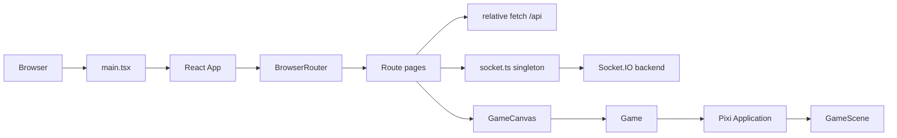

# Frontend Architecture

## Runtime layers

`AppContent` is the application coordinator. It restores the HTTP session,
stores the authenticated user, restores a room from `localStorage`, monitors
backend availability, and supplies route callbacks. It is not a global state
store: route components own their own form and UI state.

## Lifecycle

1. `main.tsx` imports `index.css` and `i18n`, then mounts `App`.
2. `App` creates the browser router.
3. `AppContent` calls `/api/auth/me`.
4. An authenticated user may create/join a room. `JoinedPayload` is stored in
   `AppContent`.
5. `/game` renders `GameCanvas`.
6. `GameCanvas` creates `Game`, subscribes to game events, and starts Pixi.
7. Unmounting removes listeners and destroys Pixi resources.

The `GameCanvas` effect depends on `joinedData` and `winner`; receiving
`game_end` therefore transitions to the end-game screen after cleanup.

## Ownership boundaries

| Concern                     | React/UI          | Pixi/game engine     | Backend                     |
| --------------------------- | ----------------- | -------------------- | --------------------------- |
| Form fields and menus       | Owns              | —                    | Receives requests           |
| Session cookie              | Sends credentials | —                    | Owns session                |
| Local movement feel         | —                 | Predicts             | Validates/corrects          |
| Render positions            | Displays HUD      | Owns sprites         | Sends authoritative updates |
| HP, resources, castle state | Displays          | Applies visual state | Calculates/authorizes       |
| Attack animation            | Triggers          | Animates             | Resolves combat             |
| Win result                  | Displays          | Stops game visuals   | Determines winner           |

There are no React Context providers or custom hooks. Communication with the
imperative engine is through the `Game` facade methods such as `syncInventory`,
`updateRemotePlayer`, `spawnCatapult`, and `updateCastleHealth`.
