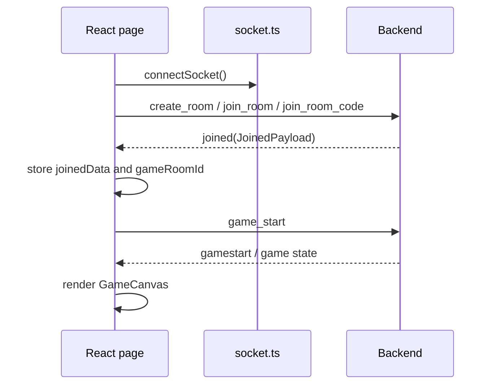

# Multiplayer and Socket.IO

## Connection lifecycle

`connectSocket()` creates one `io()` client lazily and returns the same instance
thereafter. `getSocket()` exposes it to pages/components, and
`disconnectSocket()` removes all listeners and resets the singleton. The
frontend supplies no custom URL, namespace, reconnection, or transport
configuration, so Socket.IO defaults apply.

Room pages use one-shot listeners for `joined` and `join_error`; the lobby uses
persistent listeners for `room_update` and `gamestart`; `GameCanvas` registers
the real-time game listeners for its mounted lifetime.

## Join and restore flow

On reload, `AppContent` reads `gameRoomId`, waits for the authenticated session,
creates the socket, and emits `join_room`. A failed restore removes the stale
room ID. Leaving a room or game also clears it.

## Authoritative synchronization

Local movement is predicted by `Player.update()`. The backend broadcasts
`player_move`; a matching local socket ID calls `correctLocalPlayer`, while
other IDs call `updateRemotePlayer`. Inventory, HP, castle state, catapult
state, and winner state are applied from server events or acknowledgements.

## Event inventory

The complete event list and payloads are maintained in the
[socket event tables in the main README](../README.md#7-multiplayer-and-socket-communication).
The implementation points are:

- room setup: `CreateRoom.tsx`, `JoinRoom.tsx`, `Room.tsx`;
- restoration and global leave: `App.tsx`;
- game listeners: `GameCanvas.tsx`;
- movement and combat emits: `game/scenes/GameScene.ts`;
- crafting and purchases: `components/Forgemenu.tsx`.

All game listeners registered by `GameCanvas` are removed in the effect cleanup.
The only explicit timeout is a five-second timeout around `upgrade_castle` and
`equiparmor` acknowledgements.
